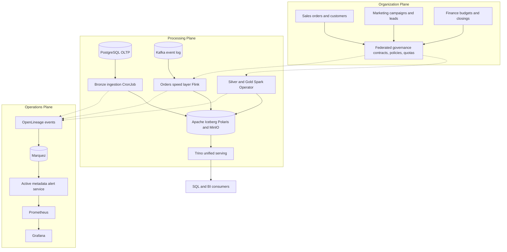
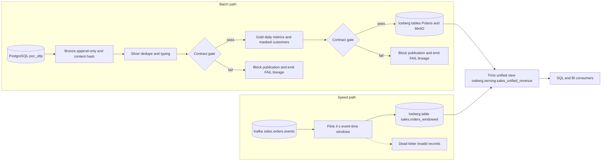
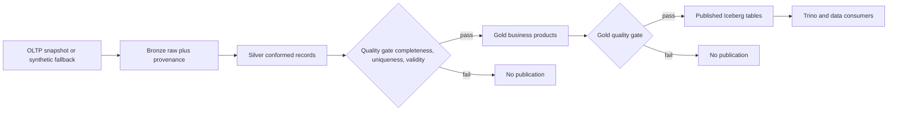
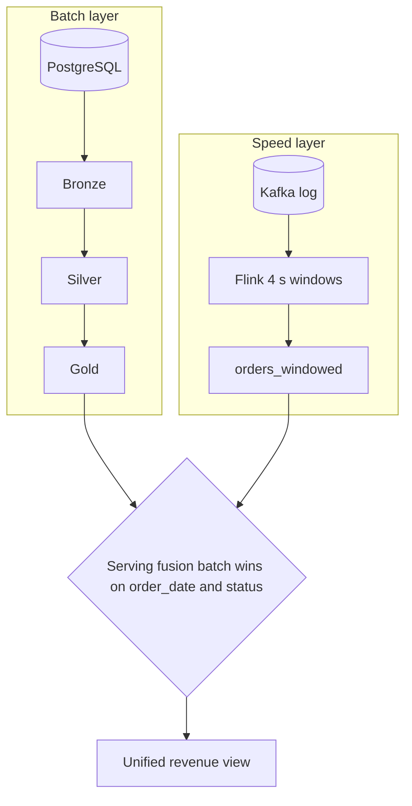
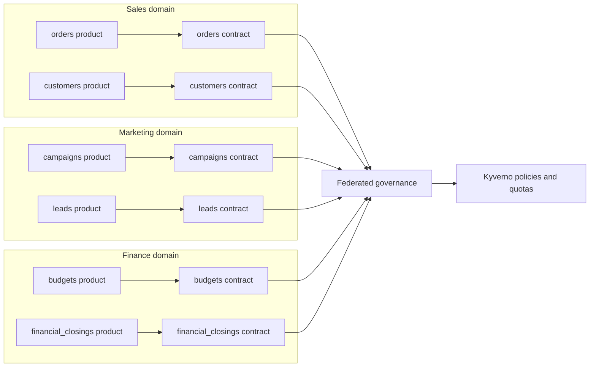
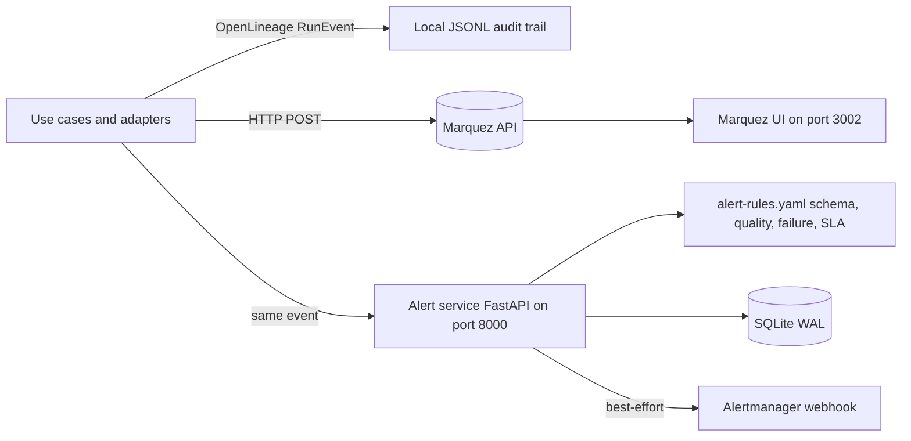
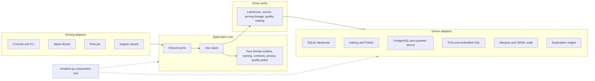
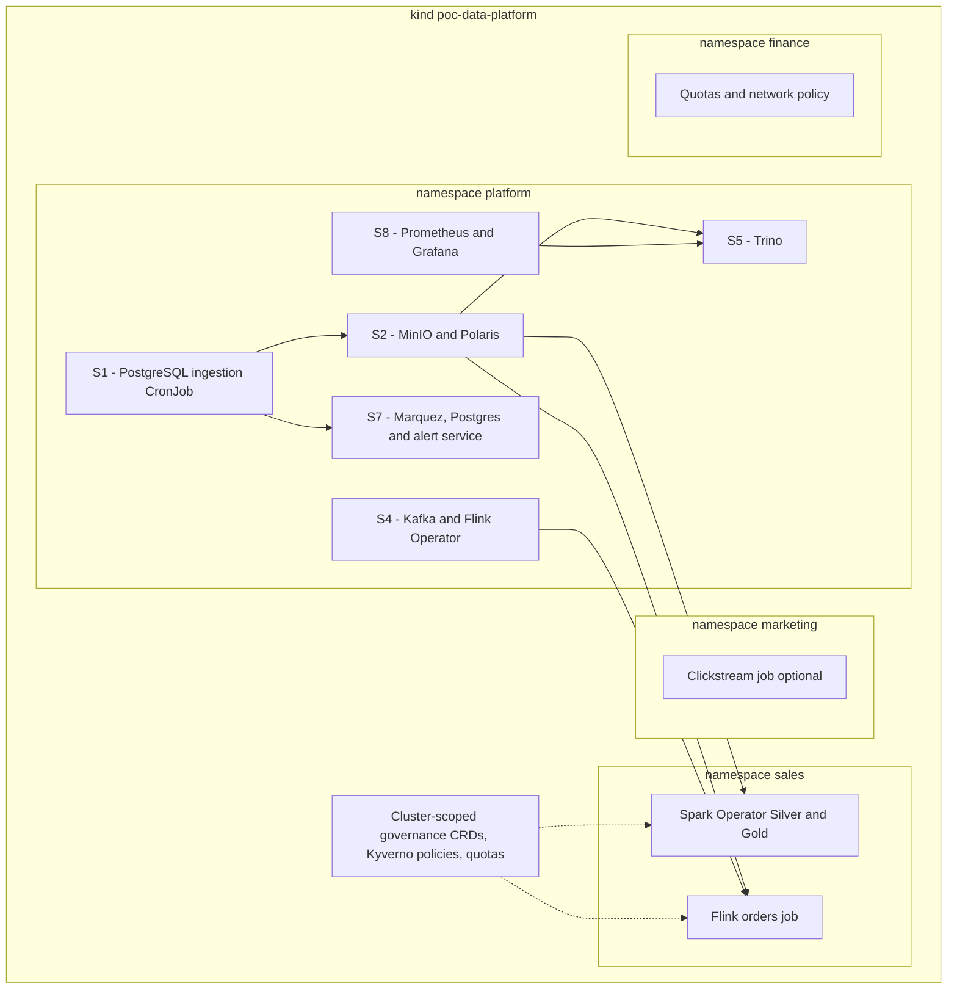
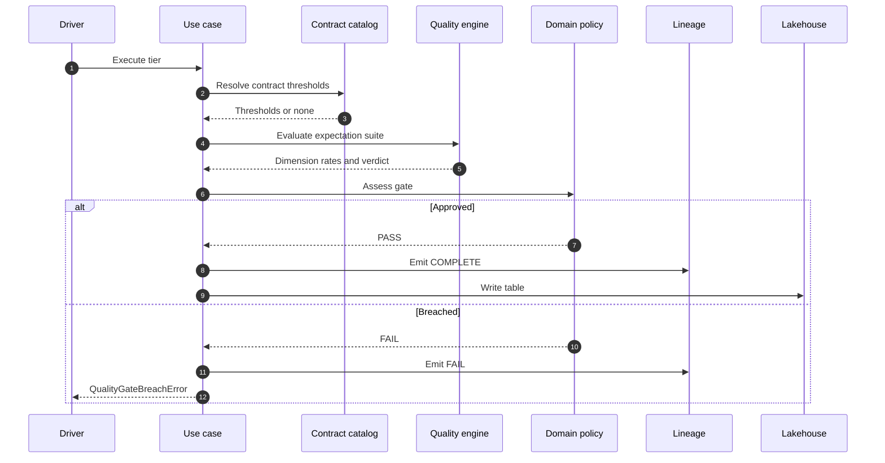

# 🧪 Cloud-Native Data Architecture POC

> 🕸️ A local-first POC of Data Mesh, Data Fabric, 🏔️ Medallion Lakehouse and ⚡ Lambda/Kappa on Kubernetes.
>
> 🧊 Iceberg + Polaris + Spark + Flink + Kafka + Trino, with ✅ contract-driven quality gates and 🔗 OpenLineage/Marquez lineage.

[](#)
[](#)
[](#)
[](#)
[](#)
[](#)
[](#)
[](#)
[](#)
[](LICENSE)

---

## Introduction

**Cloud-Native Data Architecture POC** is a local-first proof of concept for the architectural patterns that shape modern analytical platforms. It is built to be read, run and inspected: each paradigm is represented by code, a deployed workload and a verification path. The goal is to make each pattern executable and observable, not to prescribe a production reference architecture.

The platform combines a Medallion lakehouse on Apache Iceberg, a hybrid Lambda/Kappa pipeline, domain-oriented Data Mesh governance, active metadata with OpenLineage and Marquez, and a single Trino serving layer. The application core is a hexagonal Python codebase; the heavy engines run on Kubernetes.

Everything is open source and pinned. The cluster is [kind](https://kind.sigs.k8s.io/) on Podman, so the system is reproducible on a workstation without a cloud account. The local machine is used for code verification and cluster operations; the data plane lives in Kubernetes.

Use this repository to study architecture decisions, to exercise a data contract or a quality policy, or as a starting point for a larger platform.

## Project Status

| Item | Value |
| :--- | :--- |
| Status | **POC complete** — the scope is closed and no roadmap is promised |
| Maturity | Educational and architectural reference; not a production distribution |
| Verification | Local by design: every gate is a Rake command, no hosted CI is required |
| Public artifact | This repository, its Helm charts and its synthetic data generators |
| Private artifact | The detailed requirements specification is maintained outside the published tree |

The POC is considered done when the following holds, and it does today:

- the core is executable and testable without a cluster;
- every architectural claim maps to a test or a cluster probe;
- the full topology is reproducible on a workstation within the documented memory budget;
- the limitations are written down instead of discovered by the reader.

No CI service is configured on purpose: this is a local experiment, and its evidence is produced by the commands in [Testing and evidence](#testing-and-evidence). A fork intended for production work should start by replacing the demo credentials and adding TLS and secret management.

---

## Table of Contents

- [Project status](#project-status) · [Disclaimer](#disclaimer) · [How to read this repository](#how-to-read-this-repository)
- [Why this architecture?](#why-this-architecture) · [Architecture at a glance](#architecture-at-a-glance) · [End-to-end data flow](#end-to-end-data-flow)
- [Medallion lakehouse](#the-medallion-lakehouse) · [Hybrid Lambda + Kappa](#hybrid-lambda--kappa) · [Serving layer](#serving-layer)
- [Data Mesh](#data-mesh-products-and-contracts) · [Data Fabric](#data-fabric-and-active-metadata) · [Hexagonal architecture](#hexagonal-architecture)
- [Kubernetes topology](#kubernetes-deployment-topology) · [Technology stack](#technology-stack) · [Features](#features-and-capabilities)
- [Quality gates](#quality-gates) · [Quickstart](#quickstart) · [Testing and evidence](#testing-and-evidence)
- [Ports](#web-interfaces-and-ports) · [Project structure](#project-structure) · [Design decisions](#design-decisions)
- [Invariants](#architectural-invariants) · [Limitations](#known-limitations-and-non-goals) · [Troubleshooting](#troubleshooting) · [License](#contributing-security-and-license)

---

## Disclaimer

This is an educational and architectural POC, not a production distribution. It uses demo credentials, a single-node object store and catalog, embedded SQLite in selected adapters, and a deliberately small resource envelope. A production deployment needs high availability, TLS, secret management, backups, multi-tenancy and a managed catalog.

---

## How to Read This Repository

The code is layered on purpose, so it can be read in the same order the runtime executes it. A first pass takes about ten minutes and needs no cluster:

| Step | Read | Why |
| :--- | :--- | :--- |
| 1 | `src/domain/naming.py` | The naming contract every other module depends on |
| 2 | `src/ports/outbound.py` | The seams that make the engines swappable |
| 3 | `src/domain/quality_gate.py` | The promotion policy: fail-closed, contract-first |
| 4 | `src/use_cases/ingest_bronze.py`, `src/use_cases/aggregate_gold.py` | The batch flow end to end |
| 5 | `pipelines/serving/unified_view.sql` | The batch-wins fusion rule as a single query |
| 6 | `src/container.py` | The only file that chooses infrastructure |
| 7 | `domains/sales/data-products/orders/contract.yaml` | A product contract as an executable interface |

If you only read three files, read `naming.py`, `quality_gate.py` and `unified_view.sql`: they encode the three decisions that keep the rest of the repository coherent.

---

## Why This Architecture?

### Why a lakehouse?

A lakehouse removes the split between a data lake and a warehouse. **Apache Iceberg** provides ACID commits, snapshots, schema evolution and time travel over Parquet files, while **MinIO** supplies S3-compatible object storage and **Apache Polaris** exposes a REST catalog. The result is one storage layer that Spark, Flink and Trino can all read and write without copying data into a proprietary engine.

The catalog is the contract between engines: a table registered in Polaris is visible to every client, and the Iceberg metadata is the source of truth for schema and snapshots. This is what makes a single platform serve batch, streaming and interactive SQL.

### Why Medallion?

The Medallion model gives each stage of the data lifecycle a clear responsibility:

- **Bronze** preserves raw records and ingestion provenance.
- **Silver** conforms, types and deduplicates data.
- **Gold** publishes business models and analytical products.

Each transition is explicit and replayable. A quality gate sits between tiers, so a bad batch is stopped before it reaches a product. The same raw data can rebuild Silver and Gold when a rule changes, which keeps the platform auditable.

### Why a hybrid Lambda + Kappa design?

Batch and streaming solve different problems. The batch path recomputes complete historical aggregates from Silver, which makes corrections and full replays deterministic. The speed path turns Kafka events into low-latency event-time windows with Flink, and Kafka retains the log needed for Kappa-style replay.

The two paths meet at query time instead of being maintained as separate marts. Batch results are authoritative for every key they contain; stream windows only fill keys that batch has not published yet. That rule prevents double counting and keeps historical totals stable while new events arrive.

### Why Data Mesh?

Data Mesh makes domains responsible for the data they understand best. Each domain owns its products, manifests and contracts under `domains/<domain>/data-products/<product>/`. The platform supplies self-service storage, compute and guardrails, while per-domain quotas and network policies limit blast radius.

Governance is federated but executable: contracts declare schemas and quality thresholds, a validator enforces compatibility, and Kyverno policies enforce ownership, classification and naming at admission time.

### Why Data Fabric?

Data Fabric is the metadata and automation layer that connects the platform. Every pipeline emits OpenLineage run events; Marquez stores the lineage graph, and a local JSONL audit trail remains the durable source of truth for the POC. A FastAPI service evaluates active-metadata rules for schema changes, quality breaches, pipeline failures and SLA freshness.

Lineage and quality are therefore not reports produced after the fact. They are part of the execution path and can block publication.

### Why a hexagonal core?

The business logic must be testable without a cluster. The core follows **Ports and Adapters**:

- `src/domain` contains pure entities, naming rules, contracts, privacy policy and the quality-gate policy.
- `src/ports` defines inbound and outbound `Protocol`s.
- `src/use_cases` orchestrates the domain through those ports.
- `src/adapters` implements storage, source, serving, lineage and quality integrations.
- `src/container.py` is the composition root and the only place that chooses concrete implementations.

The same use case runs against SQLite or Iceberg, against Trino or embedded SQL, and against Marquez or a local audit file. Spark is a deployment mechanism for the Python drivers, not a dependency of the core: there is no `pyspark` import in `src/`.

### Why Kubernetes, Helm and profiles?

Every subsystem is a Helm chart, and every operational action is a Rake task. Kubernetes provides the scheduling, restart policies and resource isolation that make the pipeline topology explicit. kind keeps the cluster local.

The platform is intentionally profiled. Four focused profiles — `platform`, `batch`, `stream` and `serving` — cover individual workloads, while the `demo` profile describes the complete platform. A full demo needs roughly 8 GB of container limits, so smaller machines run the same topology as a sequence of exclusive phases: `platform`, `batch`, `stream`, `serving`, `fabric`, `ops` and `governance`. The lakehouse is the state that crosses phases; pods are disposable, data is not.

---

## Architecture at a Glance



---

## End-to-End Data Flow



The batch path is intentionally complete: Gold is recomputed from Silver on every run. The speed path is intentionally narrow: it aggregates order events into event-time windows and writes them to a dedicated Iceberg table. Trino is the only component that knows how to combine both paths.

---

## The Medallion Lakehouse

The lakehouse uses Iceberg as the table format, Polaris as the REST catalog and MinIO as the object store. The logical naming convention is `<tier>.<domain>.<table>`; the physical Iceberg identifier is derived by `src/domain/naming.py`.

| Tier | Logical table | Physical Iceberg table | Writer | Semantics |
| :--- | :--- | :--- | :--- | :--- |
| Bronze | `bronze.sales.orders` | `sales.bronze_orders` | `s1` ingestion CronJob | Append-only raw records, content-hash idempotency and provenance columns |
| Silver | `silver.sales.orders` | `sales.silver_orders` | Spark Operator | Typed, deduplicated records after a fail-closed quality gate |
| Gold | `gold.sales.daily_metrics` | `sales.daily_metrics` | Spark Operator | Recomputed daily sales aggregates |
| Gold | `gold.sales.customers` | `sales.customers` | Spark Operator | Customer product with masked PII |
| Speed | `stream.sales.orders_windowed` | `sales.orders_windowed` | Flink | Event-time windows upserted by window and status |

Published tiers (Gold and Speed) drop the tier from the physical identifier so products and serving views can address them by name. Internal tiers keep it to avoid collisions between Bronze and Silver.



### Bronze

Bronze records what arrived. Each row carries `_ingested_at`, `_source` and `_batch_id`, and the adapter appends only records whose content hash is not already present. Re-running an identical batch is therefore idempotent without a separate deduplication job.

Provenance is explicit: a real PostgreSQL read is labelled `postgresql.public.<entity>`, while generated fallback rows are labelled `synthetic.local.<entity>`. The platform never claims a database source it did not read.

### Silver

Silver applies the contract schema, types the columns and keeps the latest version of each business key. Before any write, the tier evaluates its expectation suite against the contract thresholds. A missing suite, an empty dataset or an unsupported assertion blocks promotion rather than silently passing.

### Gold

Gold is a full recomputation from Silver. It publishes two products:

- `daily_metrics`: daily order counts, revenue and average order value by status.
- `customers`: customer attributes with email pseudonymization and name masking.

GDPR Article 25 is implemented as code: emails are replaced by a salted SHA-256 digest and names are reduced to `First L.`. The salt is injected at the composition root, so the domain never reads environment variables.

### Time travel and evolution

Iceberg snapshots provide the historical view: an overwrite creates a new snapshot instead of destroying the previous one. Schema evolution is a metadata change, so a new column does not require rewriting existing data. The SQLite adapter used by local tests mirrors the same port semantics for versioning and idempotency.

---

## Hybrid Lambda + Kappa

The batch layer and the speed layer are deliberately asymmetric.

**Batch (Lambda).** Bronze captures source snapshots; Silver conforms them; Gold recomputes the full historical aggregate. There is no incremental Gold state to corrupt, and a rule change is applied by replaying Silver.

**Speed (Kappa).** Flink reads `sales.orders.events` from Kafka, assigns event time from the payload timestamp, applies a 500 ms out-of-orderness watermark and aggregates 4-second tumbling windows keyed by order status. Invalid payloads are dead-lettered rather than coerced.



The Flink job uses event time, 500 ms maximum out-of-orderness and 10 seconds of allowed lateness. Checkpoints run every 30 seconds in exactly-once mode to `s3a://checkpoints`, which is what makes replay and recovery meaningful. A full-log replay rotates the Kafka consumer group and rewinds to `earliest`; a group with committed offsets would otherwise ignore the rewind.

At query time, stream windows are aggregated to day grain before the anti-join. Batch rows win on `(order_date, status)`; stream rows only fill keys absent from batch. The same semantics are implemented twice, once in `QueryServingUseCase` and once in `pipelines/serving/unified_view.sql`, and both paths are covered by the serving tests and the `serving:verify` probe.

---

## Serving Layer

Trino is the single query surface over the lakehouse. The platform uses one catalog, `iceberg`, pointing at the Polaris REST catalog; batch and stream tables are namespaces inside it. The serving views hide the difference between the two paths.

```sql
SELECT order_date,
       status,
       total_orders,
       total_revenue,
       avg_order_value,
       source_tier
FROM iceberg.serving.sales_unified_revenue
WHERE order_date >= DATE '2026-01-01'
ORDER BY order_date DESC, status DESC
LIMIT 20;
```

`source_tier` tells the consumer whether a row came from `batch_historical` or `stream_speed`. The view is deployed by the `trino-views` init job from `pipelines/serving/unified_view.sql`. Trino 455 is pinned because it exposes the OAuth2 scope required by Polaris 1.8.

The serving adapter executes SQL verbatim. When `TRINO_HOST` is set it tries Trino and falls back to embedded SQLite if the query fails; otherwise it uses embedded SQLite directly. Both backends expose the same `<physical>_live` views, so local tests stay honest without rewriting queries. In the cluster, prefer `rake serving:verify`: it runs the query through the deployed Trino, so the local fallback cannot hide a missing view.

---

## Data Mesh, Products and Contracts

The repository models three domains:

| Domain | Data products | Role |
| :--- | :--- | :--- |
| Sales | `orders`, `customers` | Owns the transactional customer journey and publishes Gold products |
| Marketing | `campaigns`, `leads` | Owns campaign and lead products plus the clickstream event stream |
| Finance | `budgets`, `financial_closings` | Analytical consumer of certified Sales and Marketing products |

Each product directory contains a manifest, a contract and a JSON Schema:

```text
domains/
└── sales/
    └── data-products/
        └── orders/
            ├── product.yaml
            ├── contract.yaml
            └── schema.json
```

`product.yaml` describes the product, its owner, SLA, assets, classification and consumers. `contract.yaml` is the binding interface: schema, primary key, compatibility mode and quality thresholds.

```yaml
apiVersion: datacontract.com/v1alpha1
kind: DataContract
metadata:
  name: orders-contract
  version: "1.2.0"
  domain: sales
spec:
  compatibility_mode: BACKWARD
  schema:
    format: iceberg
    primary_key: ["id"]
  quality:
    thresholds:
      completeness: 0.98
      uniqueness: 1.00
      validity: 0.99
```

`rake governance:validate` runs structural checks, JSON Schema validation and a sibling cross-check between each product manifest and its authoritative contract. A contract change is checked for backward compatibility before it can be published.



The cluster side is equally explicit. S6 renders `DataContract` and `DataProduct` CRDs, `ClusterPolicy` objects for ownership, classification and naming, and per-domain `ResourceQuota`, `LimitRange` and `NetworkPolicy` resources. Kyverno itself is a cluster prerequisite; the chart owns the policy objects.

---

## Data Fabric and Active Metadata

Every use case can emit an OpenLineage run event. The Marquez adapter writes a local JSONL audit trail first and then posts the same event to the Marquez API. The local trail is the durable source of truth for the POC; the HTTP call is best-effort.



The alert service exposes:

- `POST /api/v1/lineage` for OpenLineage events.
- `GET /api/v1/alerts` and `GET /api/v1/alerts/{id}` for active alerts.
- `POST /api/v1/alerts/{id}/acknowledge` to acknowledge an alert.
- `GET /api/v1/lineage/{dataset}` and `GET /api/v1/datasets` for metadata exploration.
- `GET /api/v1/stats`, `GET /health` and `GET /metrics` for operations.

Four rules run on ingestion: schema changes on Silver and Gold, quality-threshold breaches, pipeline failures, and SLA freshness breaches. Events, datasets, schema history and alerts are stored in SQLite with WAL mode. Marquez keeps its own catalogue in a dedicated PostgreSQL instance.

---

## Hexagonal Architecture

The codebase is organized around a dependency rule: the domain and use cases do not know about Kubernetes, Spark, Trino, Marquez or the filesystem.



Key decisions:

- The domain is pure. It has no I/O and no framework imports.
- Ports are `Protocol`s, so tests can substitute fakes without inheritance.
- The composition root selects the lakehouse backend (`sqlite` or `iceberg`), the serving backend and the lineage adapter.
- The medallion drivers are plain Python. The Spark Operator supplies the pod, the driver and the cluster; the business logic remains in the core.

This is why the same aggregation code can be unit-tested locally, executed by a Spark driver in the cluster and inspected without a running engine.

---

## Kubernetes Deployment Topology

The local cluster is a three-node kind cluster: one control plane and two workers. Application workloads are split across the `platform`, `sales`, `marketing` and `finance` namespaces.



| Subsystem | Components | Responsibility |
| :--- | :--- | :--- |
| S1 Ingestion | PostgreSQL 16.2, ingestion CronJob | Seed and snapshot the OLTP source into Bronze |
| S2 Lakehouse | MinIO, Apache Polaris, bucket and catalog jobs | Store Iceberg data files and register tables |
| S3 Batch | Spark Operator, `ScheduledSparkApplication` | Run Silver and Gold on a schedule or on demand |
| S4 Stream | Kafka 3.7, Flink Operator, `FlinkDeployment` | Process order events into 4-second windows |
| S5 Serving | Trino 455, views init job | Expose one SQL surface over batch and stream |
| S6 Mesh | CRDs, Kyverno policies, quotas, network policies | Enforce domain ownership and platform guardrails |
| S7 Fabric | Marquez, PostgreSQL, alert service | Store lineage and evaluate active metadata rules |
| S8 Ops | Prometheus, Grafana | Scrape and visualize platform metrics |

S8 deliberately ships only Prometheus and Grafana. Dagster is an optional code-level orchestrator for batch assets; it is not a deployed UI in this topology. The same is true of Metabase, which is not part of the charts.

### Profiles and phases

The charts expose four resource profiles plus the full demo topology:

| Profile | Approximate budget | What it brings up |
| :--- | :--- | :--- |
| `platform` | ~3.0 GB | PostgreSQL, MinIO, Polaris, Marquez and the alert service |
| `batch` | ~4.0 GB | Platform storage plus the Spark Operator and medallion jobs |
| `stream` | ~2.6 GB plus kind overhead | Kafka, Flink Operator and the orders speed layer |
| `serving` | ~1.7 GB | MinIO, Polaris and Trino |
| `demo` | ~8.0 GB | The complete topology, used as a description of the whole platform |

On a 6 GiB workstation the full set of subsystems does not fit simultaneously. `rake demo:phases` runs the same topology as exclusive phases and keeps the lakehouse intact between them.

---

## Technology Stack

| Layer | Technology | Version | Role |
| :--- | :--- | :--- | :--- |
| Core | Python | 3.11+ | Hexagonal application, drivers and adapters |
| Table format | Apache Iceberg | 1.6.1 runtime, PyIceberg 0.12.0 | ACID tables, snapshots, schema evolution |
| Catalog | Apache Polaris | 1.8.0 | REST Iceberg catalog over MinIO |
| Object storage | MinIO | 2025.7.23 | S3-compatible warehouse and checkpoints |
| OLTP source | PostgreSQL | 16.2 | Demo operational database and Marquez metadata |
| Batch | Apache Spark | 3.5.1 | Spark Operator driver and executor runtime |
| Batch operator | Spark Kubernetes Operator | 1.6.2 | `ScheduledSparkApplication` lifecycle |
| Streaming | Apache Flink | 1.18.1 | Event-time windows and Iceberg sink |
| Stream operator | Flink Kubernetes Operator | 1.8.0 | `FlinkDeployment` lifecycle |
| Event log | Apache Kafka | 3.7.0 | Order and clickstream topics, replay log |
| Serving | Trino | 455 | Federated SQL over the Iceberg catalog |
| Metadata | OpenLineage and Marquez | 0.45.0 | Lineage events, dataset graph and audit |
| Alert service | FastAPI and Uvicorn | Current | Active-metadata rules and REST API |
| Orchestration | Dagster | 1.6+ | Software-defined assets for batch jobs |
| Policy | Kyverno | 1.11.4 | Admission policies and governance guardrails |
| Observability | Prometheus and Grafana | 2.48.0 / 10.2.0 | Metrics, dashboards and alerts |
| Runtime | kind, Podman, Helm | Current | Local Kubernetes cluster and packaging |
| Operations | Ruby and Rake | Current | Cross-platform task runner |

---

## Features and Capabilities

**Ingestion and storage**

- PostgreSQL snapshot ingestion with an explicit synthetic fallback and honest provenance labels.
- Append-only Bronze tables with content-hash idempotency and audit columns.
- Iceberg tables on MinIO, registered in Polaris and readable by Spark, Flink and Trino.
- Snapshot isolation, time travel and schema evolution through the table format.

**Batch and streaming**

- Medallion tiers executed by the Spark Operator on a schedule or on demand.
- Flink event-time windows with watermarks, allowed lateness, dead-lettering and exactly-once checkpoints.
- Kappa replay by rotating the Kafka consumer group and rewinding to the beginning of the log.
- Full Gold recomputation for deterministic historical corrections.

**Serving**

- One Trino catalog over batch Gold and stream windows.
- Batch-wins fusion with an anti-join, so no key is counted twice.
- `source_tier` provenance on every unified row.
- SQL that runs unchanged against Trino or the embedded SQLite adapter.

**Governance and quality**

- Product manifests, ODCS-style contracts and JSON Schemas per domain.
- Backward-compatibility validation and manifest-to-contract threshold cross-checks.
- Fail-closed quality gates with per-dimension contract thresholds.
- Kyverno policies for ownership, PII classification and naming.
- Per-domain quotas, limit ranges and network policies.

**Data Fabric**

- OpenLineage events with a local JSONL audit trail and Marquez publication.
- Active-metadata rules for schema changes, quality breaches, failures and SLA freshness.
- SQLite WAL storage for alerts, datasets and schema history.
- REST endpoints for alerts, lineage, datasets, statistics and health.

**Operations**

- Helm charts per subsystem and kind-based local cluster provisioning.
- Resource profiles for small machines and a phased end-to-end demo.
- Prometheus metrics and Grafana dashboards.
- Rake tasks for build, deploy, replay, diagnosis, verification and teardown.

---

## Quality Gates

Quality is a promotion policy, not a report. The engine evaluates Great Expectations-format suites without depending on the Great Expectations runtime, and the pure domain policy decides whether a table may be published.

- Suites live in `quality/expectations/` and describe completeness, uniqueness and validity assertions.
- Contract thresholds in `contract.yaml` govern the verdict per dimension.
- When no contract dimension is measurable, the global threshold (default `0.95`) applies.
- A missing suite, an empty dataset or an unsupported assertion fails closed.
- A breach emits a `FAIL` lineage event and raises `QualityGateBreachError` before any write.
- Gold evaluates its targets independently, so one blocked product does not hide another.



The contract is the authority. An explicit `quality_threshold` argument is only a fallback when the contract is silent, which keeps promotion and the standalone quality CLI on the same policy.

---

## Quickstart

### Prerequisites

- Podman with a machine sized for the profile you intend to run (8 GB recommended for the full demo).
- `kind`, `kubectl` and `helm`.
- Python 3.11+.
- Ruby and Rake.
- Python dependencies declared in `pyproject.toml`: the runtime set, the `dev` extra (`pytest`, `pytest-cov`, `ruff`, `mypy`) and the `contracts` extra (`jsonschema`). Without `jsonschema`, contract validation warns and checks structure only. The cluster seeder additionally needs `faker`, `numpy` and `psycopg2-binary`.
- The code runs from the repository root on `sys.path`; there is no installed distribution, so run every command from the project directory.

### Code verification

The application core and the governance rules can be verified without a cluster:

```bash
rake preflight
rake governance:validate
rake lint
rake typecheck
rake test
rake test:coverage
```

`rake` with no arguments runs governance validation, lint, type checking and the test suite.

### Bring up the cluster

```bash
rake cluster:setup
rake cluster:build
rake cluster:seed
rake cluster:up[platform]
```

`rake cluster:setup` creates or reuses the kind cluster, namespaces, storage and Helm repositories. `rake cluster:build` builds the `poc/ingest`, `poc/spark-medallion`, `poc/flink-stream` and `poc/lineage-webhook` images and loads them into every node. `rake cluster:seed` seeds the OLTP database through a port-forward.

### Run the batch path

```bash
rake cluster:up[batch]
rake batch:run
rake lakehouse:rows
```

`rake batch:run` runs Bronze through the suspended ingestion CronJob and submits the Silver and Gold `ScheduledSparkApplication` specs as one-shot `SparkApplication`s. `rake lakehouse:rows` counts the rows through Polaris and through the storage adapter, so a divergence between the catalog and the lakehouse is visible.

### Run the stream path

```bash
rake cluster:up[stream]
rake stream:deploy
rake stream:produce
rake stream:status
rake stream:logs
```

`rake stream:probe` proves the window, Iceberg and Parquet chain in a single pod without Kafka or the Flink Operator. `rake stream:replay:verify` checks that a full replay regenerates the same logical result.

### Query both paths

```bash
rake cluster:up[serving]
rake serving:verify
```

`rake serving:verify` reports the row count per `source_tier` and counts duplicated `(order_date, status)` keys; the expected duplicate count is `0`.

### Run the phased demo

```bash
rake demo:phases
```

The phases run `platform -> batch -> stream -> serving -> fabric -> ops -> governance`. You can run a subset:

```bash
rake demo:phases[batch,stream]
```

### Kappa replay

A replay requires both a fresh consumer group and `earliest`. The values live in `infra/helm/s4-stream/values.yaml` under `flinkJobs.ordersStream`, and `pipelines/orchestration/flink_replay.py` applies the same rule for orchestrated runs.

---

## Testing and Evidence

The repository contains **326 tests** collected by pytest at the release commit; the number is a snapshot of this version, not a promise. The suite is split into unit tests for the domain, ports, use cases and adapters, and integration tests for acceptance scenarios. `pytest` runs with warnings as errors to keep resource leaks and deprecations visible.

| Check | Command | Gate |
| :--- | :--- | :--- |
| Unit and integration tests | `rake test` | All tests pass |
| Coverage | `rake test:coverage` | `fail_under = 85` |
| Lint | `rake lint` | Ruff rules |
| Formatting | `rake format:check` | Ruff formatter |
| Types | `rake typecheck` | mypy with typed definitions |
| Contracts | `rake governance:validate` | Schema, compatibility and threshold checks |
| Admission control | `rake governance:verify` | A product without an owner is rejected |
| Lakehouse adapter | `rake lakehouse:probe` | Idempotent write and snapshot read |
| Speed layer | `rake stream:probe` | Windows to Iceberg to Parquet |
| Serving fusion | `rake serving:verify` | Both tiers reported and `claves_duplicadas = 0` |

Unit tests prove the code; the cluster probes prove the wiring. Both are part of the evidence, and neither is a substitute for the other.

---

## Web Interfaces and Ports

Only interfaces that are actually rendered by the charts are listed. The kind configuration forwards these NodePorts to the host.

| Service | URL | Credentials | Purpose |
| :--- | :--- | :--- | :--- |
| Trino | `http://localhost:8080` | user `trino`, no password | Interactive SQL over Iceberg |
| MinIO Console | `http://localhost:9001` | `minioadmin` / `minioadmin` | Object store browser |
| MinIO S3 API | `http://localhost:9000` | `minioadmin` / `minioadmin` | S3-compatible endpoint |
| Apache Polaris | `http://localhost:8181` | OAuth2 client credentials | Iceberg REST catalog |
| Marquez | `http://localhost:3002` | public | Lineage and dataset UI |
| Grafana | `http://localhost:3000` | `admin` / `prom-operator` | Platform dashboards |
| Kafka UI | `http://localhost:8090` | public | Topic browser, enabled per profile |

The Marquez API listens on port `5000` inside the cluster. The alert service listens on port `8000` inside the cluster and exposes `/health` and `/metrics`.

---

## Project Structure

```text
poc_data_engineering/
├── README.md
├── Rakefile
├── pyproject.toml
├── LICENSE
├── data-generator/
│   ├── oltp_seed.py
│   └── event_producer.py
├── domains/
│   ├── sales/data-products/{orders,customers}/
│   ├── marketing/data-products/{campaigns,leads}/
│   └── finance/data-products/{budgets,financial_closings}/
├── governance/
│   ├── contract_validator.py
│   ├── federation/
│   ├── policies/
│   └── schemas/
├── quality/
│   ├── expectations/
│   └── gates/
├── lineage/
│   └── config/
│       ├── lineage_webhook_service.py
│       ├── alert-rules.yaml
│       ├── openlineage.yml
│       └── Dockerfile
├── src/
│   ├── domain/
│   ├── ports/
│   ├── use_cases/
│   ├── adapters/
│   └── container.py
├── pipelines/
│   ├── medallion/
│   ├── stream/
│   ├── serving/
│   └── orchestration/
├── infra/
│   ├── helm/s1-ingestion ... s8-ops/
│   ├── docker/
│   ├── diagnostics/
│   ├── kind/
│   └── profiles/
└── tests/
    ├── unit/
    └── integration/
```

Each directory maps to an architectural concern: `src/` is the hexagonal core, `pipelines/` contains the drivers and engine jobs, `domains/` holds the Data Mesh products, `governance/` and `quality/` implement the guardrails, and `infra/` is the deployment target.

---

## Design Decisions

The repository has no separate ADR folder on purpose: the decisions that matter are short enough to live here, and each one points at the code that owns it.

| # | Decision | Rationale | Lives in |
| :--- | :--- | :--- | :--- |
| D1 | Hexagonal core with a single composition root | The business logic is testable without a cluster, and the engine choice is one line | `src/container.py` |
| D2 | Logical names `<tier>.<domain>.<table>`; published tiers drop the tier | One name per concept, mapped once instead of guessed per query | `src/domain/naming.py` |
| D3 | Content-hash idempotency in Bronze | Re-running a batch is safe without a truncate step | `src/adapters/storage/` |
| D4 | Fail-closed gate; contract thresholds win over the global default | A bad batch must stop, not be published with a warning | `src/domain/quality_gate.py` |
| D5 | Gold overwrites as supersede | A retry must not double count revenue | `src/use_cases/aggregate_gold.py` |
| D6 | Batch wins at serving time, stream fills the gaps | One number per key, stable history, low-latency novelty | `pipelines/serving/unified_view.sql` |
| D7 | Kappa replay by rotating the consumer group | A group with committed offsets ignores `earliest` | `pipelines/stream/`, `Rakefile` |
| D8 | Lineage is best-effort; the local audit trail is durable | Marquez must never block a pipeline | `src/adapters/lineage/` |
| D9 | Profiles and phases instead of one monolithic deploy | The same topology fits in 6–8 GB and stays inspectable | `infra/profiles/`, `Rakefile` |

---

## Architectural Invariants

These are the rules the code and tests are expected to preserve. If a change breaks one of them, it is an architectural change, not a refactor.

1. **The core does not import an engine.** `src/` contains no `pyspark` or `pyflink` import; Spark and Flink are deployment mechanisms.
2. **The domain does no I/O.** It has no filesystem, network or environment access; the salt, thresholds and names are injected.
3. **Every table name resolves through `naming.py`.** Drivers, adapters and serving SQL do not invent physical names.
4. **No write happens before the gate passes.** Missing suite, empty data or an unsupported assertion blocks promotion.
5. **The contract outranks the global threshold.** `0.95` is a fallback, not the policy.
6. **Batch keys shadow stream keys.** The unified view never returns two rows for the same `(order_date, status)`.
7. **An unknown backend fails at startup.** `LAKEHOUSE_BACKEND` accepts only `sqlite` or `iceberg`.
8. **A product without an owner is rejected at admission.** Governance is enforced by the API server, not only by a script.

---

## Strengths and Tradeoffs

| Area | Strength | Deliberate tradeoff |
| :--- | :--- | :--- |
| Lakehouse | One engine-neutral copy of data with ACID, snapshots and evolution | The catalog and table registration add operational steps |
| Medallion | Replayable tiers with explicit responsibilities and gates | More writes and more storage than a single-stage pipeline |
| Lambda + Kappa | Exact historical recomputation plus low-latency windows | Two processing paths and a batch-wins rule that favors stability over recency |
| Serving fusion | One SQL surface and no double counting | Stream rows are shadowed by existing batch keys |
| Hexagonal core | Testable business logic and swappable adapters | More interfaces and indirection than a script-first pipeline |
| Data Mesh | Domain ownership, quotas and executable contracts | Manifests and contracts must be maintained as products evolve |
| Data Fabric | Lineage and quality are part of execution | Alert delivery is best-effort and the local audit trail is the durable record |
| Kubernetes profiles | Reproducible on a workstation and explicit about resources | The full topology runs as phases on small machines |
| Pinned dependencies | Reproducible builds and predictable engine compatibility | Upgrades require coordinated changes across images and charts |

These are architectural choices, not accidental gaps. Each one can be revisited independently because the ports and charts isolate the decision.

---

## Known Limitations and Non-Goals

A finished POC is one whose limits are written down. These are deliberate:

| Area | Limitation | Consequence | Mitigation in the repository |
| :--- | :--- | :--- | :--- |
| Catalog | Polaris keeps its catalog in memory | A Polaris restart can lose table registrations | The S2 bootstrap job re-creates the catalog and the registration job re-registers the tables after every restart |
| Alerting | No Alertmanager is deployed; most Prometheus alert rules are commented out | Alerts stay in the alert service and SQLite, not in a pager | Four active rules in `alert-rules.yaml` and `GET /api/v1/alerts` |
| Stream freshness | Flink checkpoints every 30 s | A window is queryable only after the next checkpoint | `rake stream:status` reports job state; the replay check waits for the checkpoint |
| Window sizes | The reference use case aggregates 300 s windows; the deployed Flink job uses 4 s | The two paths are not the same granularity | Serving aggregates stream windows to day grain before the anti-join |
| Replay | The sink is an UPSERT, so row counts can grow on replay | `total-records` is not a replay-equality signal | `rake stream:replay:verify` compares a logical digest instead |
| Serving fallback | With `TRINO_HOST` set, the adapter falls back to embedded SQLite if Trino fails | A local query can succeed while the cluster view is broken | `rake serving:verify` queries the deployed Trino directly |
| Security | Demo credentials, no TLS, no authentication on Trino, no secret manager | Not safe outside a local workstation | Stated in the disclaimer and repeated here |
| Portability | Image build and load assume Podman and kind | Docker-only environments need adaptation | The Dockerfiles under `infra/docker/` are standard |
| Resources | The full topology needs about 8 GB; the clickstream job is disabled by default | Not every laptop can run everything at once | Profiles, phases and `rake ramp:*` |
| Process | No CI service | Evidence is only as fresh as the last local run | Every gate is a single Rake command |

**Non-goals.** This POC does not attempt high availability, backups or disaster recovery, multi-tenancy or end-user authentication, a bundled BI front end, cost optimisation, CDC or a schema registry, or production SLOs. Those are platform concerns that belong to the deployment around it, not to the architectural demonstration.

---

## Troubleshooting

| Symptom | Likely cause | Action |
| :--- | :--- | :--- |
| `ValueError: Unknown LAKEHOUSE_BACKEND` | Typo or unsupported value | Use `sqlite` or `iceberg`; the container refuses to guess |
| A Trino query fails but the local query passes | The serving adapter fell back to SQLite | Check `TRINO_HOST`, then run `rake serving:verify` |
| A replay does not rewrite the windows | The consumer group has committed offsets, so `earliest` is ignored | Rotate `kafkaGroupId` and redeploy the job |
| Polaris answers `401` | Missing OAuth client or scope | Check the S2 values; Trino 455 is pinned for the Polaris 1.8 scope |
| Spark pods stay `Pending` | The kind VM has no room left | Run the demo as phases or use `rake ramp:*` |
| Pods run stale code | Images were rebuilt but not reloaded into the nodes | `rake cluster:build` loads them into every node |
| The unified view is missing | The S5 views init job did not run | Redeploy the `serving` profile, then `rake serving:verify` |

---

## Contributing, Security and License

This is a finished POC, not a product with a support contract. Issues and pull requests that fix a defect, correct documentation or add a reproducible probe are welcome; feature requests may be closed as out of scope.

- **Security.** Do not open a public issue containing a vulnerability or a credential. The credentials in the charts (`minioadmin`, `admin/prom-operator`, the passwordless Trino user) are intentional and must be replaced before any non-local use.
- **Data.** Every dataset is synthetic or generated at runtime. No personal data is shipped, and the PII masking rules are demonstrated on generated records.
- **Scope.** The requirements specification is not part of this repository by design. The public contract is this README plus the contracts under `domains/`.
- **License.** MIT. See [LICENSE](LICENSE). Copyright (c) 2026 Sergio Sánchez.
